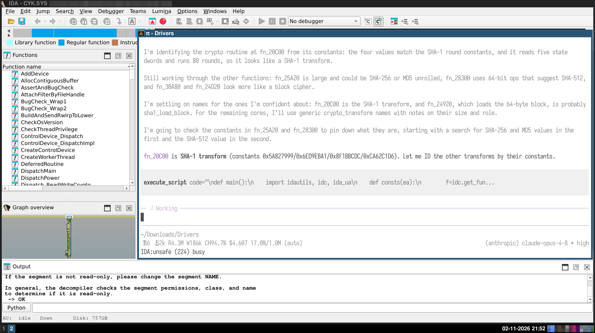
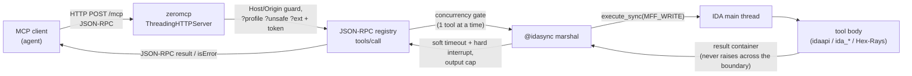

# ida_mcp - IDA Pro MCP Plugin
`ida_mcp` exposes a running IDA Pro session to AI coding agents through the [Model Context Protocol (MCP)](https://modelcontextprotocol.io/). An agent connected to the plugin can inspect the open binary, decompile functions, walk cross-references, query types, strings, segments and metadata. When explicitly permitted, annotate the database, patch bytes, run scripts, and drive the debugger.

It is built specifically for reverse-engineering workflows: read-first, lazy tool loading so small models stay on-task, and a strict opt-in gate for anything that mutates the IDB.

Special thanks to [Eduardo](https://github.com/lluiseduardo-silva), which provided means for further improving the project.

## In action



An agent running inside the IDA session identifies a SHA-1 transform from its round constants (`fn_20C00`), plans the renames, and executes an IDAPython snippet - all over MCP.

## What it does
- **Decompilation & disassembly**: Hex-Rays pseudocode, linear and structured disassembly, microcode summaries, flowcharts and CFG blocks.
- **Binary triage in one call**: `survey_binary()` returns metadata, stats, segments, entry points, notable strings/functions, categorized imports and a call-graph summary.
- **Function & component analysis**: per-function summaries, data-flow traces, bounded call-graphs, numeric profiles, and before/after diffs for rename/type/comment actions.
- **Deep queries**: filterable queries over functions, globals, imports, strings and names, plus typed memory readers, head navigation, and directional xrefs (code/data, calls/jumps, reads/writes).
- **Types, segments, metadata**: local type catalog, struct/enum management, segment permissions, compiler/arch info, file hashes, analysis status.
- **Search & signatures**: byte patterns with `??` wildcards, text/immediate/regex search, and shortest-unique signatures in `ida` / `x64dbg` / `mask` / `bitmask` formats.
- **Annotations & patches (gated)**: comments, renames, bookmarks, FLIRT signatures, data definition, asm/byte patching with revert support, and arbitrary IDA Python execution.
- **Debugger & tracers (gated)**: breakpoints, registers, stack, memory reads/writes, plus passive IDB / Hex-Rays / debugger hooks.

## Design
- **Zero dependencies.** The MCP transport is a vendored, trimmed server (`ida_mcp/zeromcp`) on top of stdlib `ThreadingHTTPServer`. No `mcp`, `uvicorn`, `fastapi` or `pip` packages at runtime.
- **Main-thread safety.** All IDA API calls are marshalled to the IDA main thread via `idaapi.execute_sync` through an `@idasync` layer with a queue-based result container, timeouts and cancellation support.
- **Simple tool model.** Tools are plain Python functions registered with `@tool` into a single `MCP_SERVER` registry. Unsafe tools are marked with `@unsafe` and hidden/refused unless the client opts in.
- **Lazy profiles.** Clients start with a 16-tool `triage` profile and escalate to `readonly` and then the full set only as needed, keeping agent context small.
- **Multi-instance aware.** A second IDA whose port is taken falls back to the next free one (up to +9), and running instances register themselves on disk so tooling can discover and address several open IDA sessions.
- **IDA 9.x native.** Uses current APIs (`idaapi.BADADDR`, `insn.get_canon_mnem()`, `ida_bytes.find_bytes()`, `inf_get_min_ea/max_ea`) with shims for 8.3+ in `compat.py`.

### Request flow
A tool call crosses the HTTP boundary (where auth / profile / unsafe / ext are enforced), is admitted one-at-a-time, then is marshalled onto the IDA main thread where the SDK is actually touched:



In one line: **client → HTTP (gated) → registry (serialized) → `@idasync` → IDA main thread → tool → result back**, with a soft timeout, hard interrupt, and output cap bounding every call.

## Error convention
Tools signal a **hard failure** in one of two equivalent ways, both surfaced to the client as `isError: true` on the `tools/call` result:

- **Raise `IDAError(msg)`** - used by plain-text tools (e.g. `decompile_function`, `get_disassembly`) where an error string would otherwise be indistinguishable from a successful result. It maps to a clean JSON-RPC `-32000` with no traceback leak.
- **Sync-layer failures use the same path** - timeouts, dropped `execute_sync` requests and aborted tools raise `IDASyncError`, which is also a tool error: the client sees `isError: true` with the plain message (e.g. `Tool timed out after 60.00s`), never a traceback of the sync wrapper.
- **Return a JSON object with a non-empty top-level `error` string** - used by the JSON tools. The MCP boundary parses the result and promotes a top-level `error` to `isError: true`, also exposing the parsed object as `structuredContent`.

Deliberately **not** treated as failures: `error: null` on an otherwise-successful payload, soft notes under a separate key (`warning`), and per-item errors nested inside a list/batch result (the top level is then a list, not an `error` object). This lets an agent detect failures programmatically instead of string-matching the content.

## Output limits
Listing tools that can grow with the binary (`get_functions`, `get_callees`, `get_all_comments`, `get_entry_points`, `type_query`, plus the query/string listings) take `limit` / `offset` for pagination - a full page means more may follow, so advance `offset` (or narrow with a filter). An oversized `limit`/`size` is **clamped** to the tool's documented maximum and the applied value is echoed in the payload (`limit`, or `requested`+`truncated` for `get_bytes`), never silently reset to the default. As a universal backstop, any tool result whose text exceeds `max_output_chars` (default 512 KiB, set via `IDA_MCP_MAX_OUTPUT`) is refused with an actionable `isError` instead of flooding the agent's context. Refusing rather than truncating is deliberate: a JSON body cut short would leave `structuredContent` invalid for the client, so the fix is to narrow the request (or raise the cap).

## Long-running tools & timeouts
Every tool runs on the IDA main thread, so while one runs the IDA UI is frozen and other calls get a retryable `Server busy`. To keep that bounded:

- **Soft timeout** - `IDA_MCP_TOOL_TIMEOUT_SEC` (default 60s). At the deadline IDA's cancel flag is set (SDK loops bail), and after a 5s grace a `BaseException` is raised in the tool body, so a script's `try/except Exception` cannot swallow it. `execute_script` / `py_eval` return the output printed so far, plus an error; every other tool returns `isError: true` with `Tool timed out after Ns`.
- **Hard interrupt** (script tools only) - if a script still runs about 5s later (bare `except:`, or a call-free `while True` loop), a watchdog injects the interrupt asynchronously, retrying up to 10 times. Long SDK calls are interrupted as soon as they return to Python. Disable with `IDA_MCP_NO_HARD_INTERRUPT=1`.
- **Cancellation** - `notifications/cancelled` for the request id interrupts the tool the same way. The IDA wait box's Cancel button works too, because the server polls it every 300 ms while a tool runs, which also repaints the box. Disable that polling with `IDA_MCP_UI_PUMP=0`.
- **Clients** - set the client's tool-call timeout above the server's (pi bridge: `IDA_MCP_CLIENT_TIMEOUT_MS`, default 90000). A client that gives up first should send `notifications/cancelled` and report "busy", not "offline". Health checks should use JSON-RPC `ping`, which does not need the main thread.

## Configuration
Everything is configured through environment variables - there is no config file. All are optional; defaults are chosen for a safe, read-only, single-session workflow.

**Server (set in IDA's environment, read by the plugin/loader):**

| Variable | Default | Effect |
|----------|---------|--------|
| `IDA_MCP_HOST` | `127.0.0.1` | Bind address. Wins over a host persisted in the IDB (a non-loopback IDB value is ignored with a warning); set this to bind off-loopback deliberately. |
| `IDA_MCP_TOKEN` | random per start | Pin a stable auth token for the unsafe/debugger surface instead of the per-start random one. |
| `IDA_MCP_NO_AUTH` | unset | `1`/`true`/`yes` disables the auth token entirely - unsafe tools become reachable by any local client. Trusted single-user boxes only. |
| `IDA_MCP_REQUIRE_TOKEN` | unset | `1`/`true`/`yes` requires the token on **every** request, read-only tools and loopback included (off by default). Ignored, with a warning at startup, when `IDA_MCP_NO_AUTH` is also set. |
| `IDA_MCP_TOOL_TIMEOUT_SEC` | `60` | Soft per-tool timeout (seconds) before IDA's cancel flag is set and the tool body is interrupted. |
| `IDA_MCP_NO_HARD_INTERRUPT` | unset | `1`/`true`/`yes` disables the script-only hard-interrupt watchdog (for scripts that swallow the soft timeout). |
| `IDA_MCP_UI_PUMP` | on | `0`/`false`/`no`/`off` disables wait-box polling - the Cancel button and its repaint stop working while a tool runs. |
| `IDA_MCP_MAX_OUTPUT` | `524288` (512 KiB) | Max characters in a tool result before it is refused with an actionable `isError`. Accepts `0x` hex; `0` disables the cap. |
| `IDA_MCP_LOG` | off | `debug`/`info`/`warning` (or `1`/`true`) routes `ida_mcp` package logs (per-tool main-thread hold times, lifecycle) to the IDA output window. |
| `IDA_MCP_AUDIT` | off | Path to a JSONL file. When set, every mutating (unsafe/debugger) tool call appends an audit record (`ts`, `tool`, `ok`, `level` = `unsafe`/`dbg`, size-bounded `args`, plus `code_sha256`/`code_len` for the script tools and `error` on failure). Read-only tools are not logged. |
| `IDA_MCP_AUDIT_FULL` | off | `1`/`true`/`yes`: with `IDA_MCP_AUDIT` set, also append the **untruncated** tool arguments to `<audit_path>.args.jsonl`, and point the main record at the sidecar (`args_full`). The page of the full `execute_script` body is there; the main file stays small. |
| `IDA_MCP_REDACT_ERRORS` | unset | `1`/`true`/`yes`: an unexpected exception in a tool returns only `Internal Error: <type>: <message>` instead of the full traceback, which is logged in IDA instead (see `IDA_MCP_LOG`). Consider it when untrusted clients can connect. |

**Client (pi bridge, set in the pi/agent environment):**

| Variable | Default | Effect |
|----------|---------|--------|
| `IDA_MCP_URL` | `http://127.0.0.1:13337/mcp` | Server URL the pi extension proxies. |
| `IDA_MCP_TOKEN` | unset | Auth token the pi extension sends as `X-IDA-MCP-Token` (needed for the `unsafe`/`dbg` levels). Same name as the server variable, so one value in a shared environment pins and supplies the token. |
| `IDA_MCP_CLIENT_TIMEOUT_MS` | `90000` | Client tool-call timeout. Keep it above the server's `IDA_MCP_TOOL_TIMEOUT_SEC` so the client reports "busy" (and cancels) rather than "offline". |

## Safety model
By default the server is **read-only**. Mutating tools (renames, comments, type application, patching, script execution, IDB hooks) are invisible and rejected unless the endpoint is opened with `?unsafe=true`. Debugger tools additionally require the `dbg` extension group (`?unsafe=true&ext=dbg`). Profiles (`?profile=triage` / `?profile=readonly`) further restrict which tools are listed, so an agent only sees what the task requires; an unknown profile name is rejected (`-32602`, naming the available ones) instead of being ignored, which used to widen the tool list silently.

**Auth token for the unsafe surface.** Because `?unsafe=true` exposes script execution and patching (effectively local RCE), the unsafe and debugger tools additionally require a secret token - loopback binding and the DNS-rebinding/Origin guards do not stop another local process or user. On startup the server prints a random token to the IDA output window; clients pass it as the `X-IDA-MCP-Token` header or `?token=<token>`. Read-only tools need no token while the server is bound to loopback; bound anywhere else, every request needs it (HTTP 401 otherwise), since the Host guard cannot apply there. Set `IDA_MCP_TOKEN` to pin a stable token for a fixed client config, or `IDA_MCP_NO_AUTH=1` to disable auth on a trusted single-user workstation. On a shared or potentially compromised box, `IDA_MCP_REQUIRE_TOKEN=1` asks for the token on every request (read-only tools included) while staying on loopback. The token is never written to the discovery file.

**Session ids.** `initialize` returns an `Mcp-Session-Id` and the server tracks it. A request that carries an id it did not issue (stale, expired, or from a previous IDA run) gets `404`, which is the Streamable HTTP signal to `initialize` again; `DELETE /mcp` ends the session. Requests with no id keep working, so the `curl` examples and stateless clients are unaffected.

**Instance discovery.** Running instances register a small JSON file under the IDA user directory, and `list_instances` probes it to drop stale entries. Only addresses that can be this machine are probed (loopback, the wildcard bind, or one of this host's own addresses); an entry naming anything else is reported with `unverified: true` instead of making IDA open a connection to it, and hostnames are never resolved.

**Connection limits.** The threaded server serves at most `max_connections` (64) sockets at a time and answers `503` beyond that; a connection that sends no request is closed after 30 s. Both bound a local process that opens sockets to exhaust IDA's threads.

**Bind address.** The server binds `127.0.0.1`. A host persisted in the IDB is honored only when it is loopback (an IDB may come from someone else and must not silently move the server onto the network); a non-loopback value is ignored with a warning. To bind elsewhere, set `IDA_MCP_HOST` in IDA's environment; every request then needs the token, and traffic is plain HTTP, so use a trusted network or a tunnel. Client regexes (`find_regex`, `func_query`, `entity_query`, `/re/` filters) reject nested quantifiers such as `(a+)+`, which backtrack exponentially on the IDA main thread where the tool timeout cannot interrupt them; use a possessive `++` or atomic `(?>...)` group instead.

## Tool surface
The plugin exposes 242 tools across 22 modules:

| Area | Examples |
|------|----------|
| Core analysis | `decompile_function`, `get_disassembly`, `disasm`, `lookup_funcs`, `basic_blocks` |
| Composite | `survey_binary`, `analyze_function`, `analyze_component`, `trace_data_flow`, `callgraph`, `func_profile` |
| Queries | `func_query`, `entity_query`, `imports_query`, `list_globals` |
| Xrefs & graphs | `get_xrefs_to`, `xref_query`, `get_callers`, `get_callees`, directional reads/writes/calls/jumps |
| Memory & data | `get_bytes`, `get_string`, scalar readers (`get_byte`…`get_qword`, floats), `get_heads`, BSS-safe reads |
| Strings / imports / exports | paginated listing, search, counts, range queries |
| Types | `type_query`, `type_inspect`, `read_struct`, `declare_type`, `enum_upsert` |
| Segments / functions / instructions | bounds, signatures, flags, locals, operands, predicates |
| Metadata | binary info, arch/compiler, hashes, Hex-Rays version, analysis status, IDB meta |
| Comments & bookmarks | regular/repeatable/extra comments, bookmarks |
| Search | bytes, text, immediates, regex, ranged search |
| Signatures | `make_signature*`, `find_xref_signatures`, FLIRT apply/list |
| Entries | listing, ordinal/name/address lookup, add/rename |
| Server | `server_health`, `server_warmup`, `list_instances` |
| Unsafe (opt-in) | `set_name`, `set_comment`, `patch_bytes`, `patch_asm`, `execute_script`, `py_eval` |
| Debugger (opt-in) | `dbg_start`, `dbg_continue`, `dbg_step_into/over`, breakpoints, `dbg_regs`, `dbg_stacktrace`, `dbg_read/write` |
| Hooks (tracers) | `install_hook`, `install_hexrays_hook`, `install_idb_hook`, `get_hook_info` |

All addresses accept hex (`0x401000`), decimal, or symbol names.

## Tool inventory

Every registered tool, grouped by module (names match `tools/list` exactly).

### `api_analysis` (15)

`basic_blocks`, `disasm`, `find_bytes`, `get_bytes`, `get_callees`, `get_callers`, `get_string`, `get_xrefs_to`, `int_convert`, `list_exports`, `list_imports`, `lookup_funcs`, `rename_function`, `set_comment`, `xref_query`

### `api_comments` (10)

`add_bookmark`, `delete_bookmark`, `delete_comment`, `get_all_comments`, `get_bookmarks`, `get_comment`, `get_extra_comments`, `get_repeatable_comment`, `set_extra_comment`, `set_repeatable_comment`

### `api_composite` (7)

`analyze_component`, `analyze_function`, `callgraph`, `diff_before_after`, `func_profile`, `survey_binary`, `trace_data_flow`

### `api_debug` (19)

`dbg_add_bp`, `dbg_bps`, `dbg_continue`, `dbg_delete_bp`, `dbg_exit`, `dbg_get_threads`, `dbg_gpregs`, `dbg_read`, `dbg_regs`, `dbg_regs_named`, `dbg_run_to`, `dbg_set_bp_condition`, `dbg_stacktrace`, `dbg_start`, `dbg_status`, `dbg_step_into`, `dbg_step_over`, `dbg_toggle_bp`, `dbg_write`

### `api_entries` (8)

`add_entry_point`, `get_entry_forwarders`, `get_entry_point_at`, `get_entry_point_by_name`, `get_entry_point_by_ordinal`, `get_entry_point_count`, `get_entry_points`, `rename_entry_point`

### `api_functions` (25)

`create_function`, `delete_function`, `func_count`, `get_function_args_size`, `get_function_bounds`, `get_function_comment`, `get_function_edges`, `get_function_end`, `get_function_flags`, `get_function_frame_size`, `get_function_instructions_count`, `get_function_signature`, `get_function_size`, `get_function_start`, `get_function_type`, `get_functions_in_range`, `get_local_variables`, `get_next_function`, `get_register_variables`, `is_function_library`, `is_function_noreturn`, `is_function_thunk`, `list_funcs`, `set_function_comment`, `set_function_name`

### `api_hexrays` (4)

`force_recompile`, `get_basic_blocks`, `get_flowchart`, `get_microcode`

### `api_hooks` (5)

`get_hook_info`, `install_hexrays_hook`, `install_hook`, `install_idb_hook`, `remove_hooks`

### `api_info` (18)

`get_analysis_prompt`, `get_analysis_status`, `get_architecture_info`, `get_base_address`, `get_binary_info`, `get_compiler_info`, `get_current_binary_name`, `get_hexrays_version`, `get_image_size`, `get_input_file_md5`, `get_input_file_path`, `get_input_file_sha256`, `get_problems`, `get_processor_info`, `get_version_info`, `idb_meta`, `idb_save`, `wait_for_analysis`

### `api_instructions` (16)

`breaks_flow`, `get_instruction`, `get_instruction_bytes`, `get_instruction_size`, `get_instructions`, `get_instructions_in_range`, `get_mnemonic`, `get_operand`, `get_operand_info`, `get_operands`, `get_operands_count`, `is_call_instruction`, `is_conditional_jump`, `is_indirect_jump`, `is_jump_instruction`, `is_ret_instruction`

### `api_memory` (19)

`get_byte`, `get_cstring`, `get_data_flags`, `get_data_size`, `get_disassembly_text`, `get_double`, `get_dword`, `get_float`, `get_global_value`, `get_heads`, `get_int`, `get_next_addr`, `get_next_head`, `get_prev_addr`, `get_prev_head`, `get_qword`, `get_word`, `is_code`, `is_data`

### `api_modify` (8)

`get_original_bytes`, `list_patches`, `make_data`, `patch_asm`, `patch_bytes`, `rename_address`, `revert_patch`, `undefine`

### `api_names` (12)

`delete_name`, `demangle_name`, `force_name`, `get_all_names`, `get_demangled_name`, `get_name`, `is_name_public`, `is_name_weak`, `make_name_non_public`, `make_name_public`, `set_name`, `validate_name`

### `api_python` (2)

`py_eval`, `py_exec_file`

### `api_query` (6)

`entity_query`, `func_query`, `get_local_variable_by_name`, `get_local_variable_references`, `imports_query`, `list_globals`

### `api_search` (7)

`find_bytes_between`, `find_immediate_between`, `find_regex`, `find_text_between`, `search_bytes`, `search_immediate_value`, `search_text`

### `api_segments` (13)

`get_code_segments`, `get_data_segments`, `get_segment_at`, `get_segment_bitness`, `get_segment_by_name`, `get_segment_class`, `get_segment_comment`, `get_segment_count`, `get_segment_end`, `get_segment_permissions`, `get_segment_size`, `get_segment_start`, `get_segments`

### `api_sigmaker` (6)

`apply_flirt_signatures`, `find_xref_signatures`, `list_flirt_signatures`, `make_signature`, `make_signature_for_function`, `make_signature_for_range`

### `api_strings` (9)

`get_ascii_strings`, `get_string_at`, `get_string_count`, `get_strings_by_length`, `get_strings_in_range`, `get_unicode_strings`, `list_strings`, `search_strings`

### `api_typeinfo` (10)

`declare_type`, `enum_upsert`, `get_type_at`, `get_type_by_name`, `infer_types`, `read_struct`, `search_structs`, `set_type`, `type_inspect`, `type_query`

### `api_xrefs` (15)

`get_callee_count`, `get_caller_count`, `get_calls_from`, `get_calls_to`, `get_code_refs_from`, `get_code_refs_to`, `get_data_refs_from`, `get_data_refs_to`, `get_jumps_to`, `get_reads_of`, `get_writes_to`, `get_xref_count`, `get_xrefs`, `get_xrefs_from`, `xrefs_to_field`

### `server` (9)

`close_instance`, `decompile_function`, `execute_script`, `get_disassembly`, `get_functions`, `get_instance_info`, `list_instances`, `server_health`, `server_warmup`

<!-- total: 242 tools -->

## How it works
```
MCP client -> HTTP POST /mcp -> request handler
                                     |
                          unsafe/profile gate (per-request)
                                     |
                                     v
                           MCP_SERVER.dispatch
                                     |
                                     v
                        tool function (@tool + @idasync)
                                     |
                                     v
                 idaapi.execute_sync --> IDA main thread
```

The handler parses `?unsafe=` / `?profile=` / `?ext=` per request (thread-local, no races), dispatches JSON-RPC `tools/list` and `tools/call` against the registry, and marshals IDA-touching calls onto the main thread with a timeout that can cancel stuck operations.

## Agent skills
Two skills ship in both `skills/` (Claude Code / Cursor / Copilot) and `.pi/skills/` (Pi Agent):

| Skill | What it does |
|-------|--------------|
| `ida` | Orchestrator (`/ida`): connect -> `survey_binary()` triage -> escalate `triage -> readonly -> full -> unsafe -> dbg` only as the task needs |
| `ida-scripting` | Write and execute IDAPython scripts (full API reference) |

## Layout
| Path | Purpose |
|------|---------|
| `ida_mcp_loader.py` | IDA plugin entry point (`PLUGIN_ENTRY`) |
| `ida_mcp/server.py` | Core tools, server lifecycle, module wiring |
| `ida_mcp/api_*.py` | Tool modules (analysis, functions, xrefs, memory, strings, types, segments, instructions, info, comments, names, composite, query, hexrays, debug, hooks, sigmaker, search, modify, entries) |
| `ida_mcp/rpc.py` | `@tool` / `@unsafe` decorators and registry |
| `ida_mcp/sync.py` | `@idasync` main-thread bridge |
| `ida_mcp/profiles.py` + `profiles/` | Lazy-loading tool allowlists (`triage`, `readonly`) |
| `ida_mcp/compat.py` | IDA 8.3 to 9.x API shims |
| `ida_mcp/regex_guard.py` | Rejects ReDoS-prone client regexes before compiling |
| `ida_mcp/discovery.py` | Multi-instance registration/discovery |
| `ida_mcp/zeromcp/` | Vendored stdlib MCP transport |
| `skills/ida/`, `skills/ida-scripting/` | Generic agent skills (Claude Code/Cursor/Copilot): `/ida` orchestrator (connect -> triage -> escalate) + IDAPython scripting |
| `.pi/skills/ida/SKILL.md`, `.pi/skills/ida-scripting/` | Same skills for the Pi Agent (pi-formatted frontmatter), auto-loaded by pi |
| `.pi/extensions/ida-mcp.ts` | Pi Agent extension: MCP bridge, `/ida` command, `ida_profile` / `ida_status` tools, footer status indicator |
| `tests/` | Standalone test scripts (run outside IDA with stubbed IDA modules) |
| `CONTRIBUTING.md` | Architecture, the drift-guard invariants, and the add-a-tool flow |

## Pi Agent integration
This repo includes a ready-to-use skill and extension for the [Pi Agent](https://github.com/earendil-works/pi). Just copy the contents of the `.pi` folder to your user's Pi Agent folder.

| Path | What it provides |
|------|------------------|
| `.pi/skills/ida/SKILL.md` | `/ida` skill: verify the bridge (`server_health`), triage with `survey_binary()`, then escalate `triage (16 tools) -> readonly (185) -> full (185, unfiltered) -> unsafe (223) -> dbg (242)` only as needed |
| `.pi/skills/ida-scripting/` | IDAPython scripting skill with the full API reference |
| `.pi/extensions/ida-mcp.ts` | Extension bridge: proxies the plugin's Streamable-HTTP server (`http://127.0.0.1:13337/mcp`) into pi tools with lazy loading, `/ida [status\|triage\|readonly\|full\|unsafe\|dbg\|tools]` command, `ida_profile` / `ida_status` management tools, and a live `IDA:online/offline` footer indicator (polling + session-event refresh) |

- Endpoint ladder mirrors `INSTALL.md`: `?profile=triage` (default) -> `?profile=readonly` -> full -> `?unsafe=true` -> `?unsafe=true&ext=dbg`.
- Override the server URL with `IDA_MCP_URL` (default `http://127.0.0.1:13337/mcp`).
- Just type `/ida` in pi and start reversing the binary open in IDA Pro.

## Notes
- `decompile_function` output is plain text capped at 2000 lines. Everything else returns JSON.
- `get_bytes` is BSS-safe (unloaded bytes read as `0x00`).
- Oversized request bodies, non-loopback `Host` headers and foreign `Origin` values are rejected.
- Besides tools, the server exposes MCP **resources** (`ida://triage` → `survey_binary`, `ida://health` → `server_health`) and a **prompt** (`reverse-engineer`), so a client can attach binary context without a tool call. These are read-only and advertised in `initialize` capabilities.
- `server_health` reports per-tool call/error counts and main-thread timing (`stats`); set `IDA_MCP_AUDIT=<path>` for a JSONL trail of mutating calls.
- Timeouts, host/port and autostart are configurable; per-IDB settings persist via netnodes.
- Requires IDA Pro 8.3+ (9.3 recommended) with Python 3.11+; IDA Free is not supported and Hex-Rays is needed for decompiler-backed tools.
